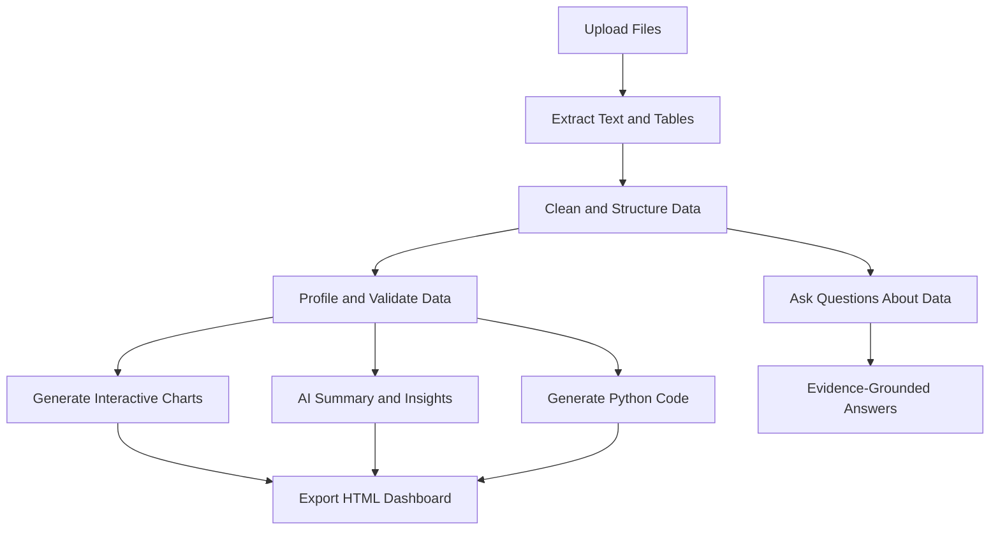

# 🧠 Advanced Deep Analysis AI Agent

**Transform documents into data, insights, interactive charts, and executive-ready dashboards with AI.**

Advanced Deep Analysis AI Agent is an AI-powered document and data analytics application that helps users analyze uploaded files, extract structured information, visualize trends, generate Python analysis code, and ask questions about their data through a conversational interface.

The application combines Python, Streamlit, Pandas, Plotly, and OpenAI-powered language models to simplify document analysis and data exploration.

## ✨ Key Features

- 📂 **Multi-Format File Upload** — Upload PDF, Excel, CSV, JSON, TXT, and Word documents.
- 📄 **Intelligent PDF Analysis** — Extract text and tables from PDFs, with AI-assisted table extraction when native extraction is insufficient.
- 📊 **Automatic Data Profiling** — Explore row counts, columns, data types, missing values, and duplicate records.
- 📈 **Interactive Visualizations** — Generate charts based on detected numeric, categorical, and time-related data.
- 🧠 **AI-Powered Summaries** — Generate executive summaries, key findings, trends, risks, and recommendations grounded in uploaded content.
- 💬 **Ask Your Data** — Ask natural-language questions about uploaded documents and datasets.
- 🐍 **Python Code Generation** — Generate reusable Python scripts for data analysis.
- 🌐 **HTML Dashboard Export** — Export an interactive dashboard with charts, extracted tables, and summaries.
- 🎨 **Modern Analytics Interface** — Dark-themed dashboard with gradient styling and interactive components.

## 🔄 How It Works



## 🛠️ Technology Stack

| Technology | Purpose |
|---|---|
| Python | Application logic and data processing |
| Streamlit | Interactive web application |
| Pandas | Data manipulation and analysis |
| Plotly | Interactive charts and visualizations |
| pdfplumber | PDF text and table extraction |
| python-docx | Word document processing |
| OpenAI API | AI-powered extraction, summaries, and Q&A |
| LangChain | Language model integration |
| HTML and CSS | Dashboard styling and HTML export |

## 📁 Supported File Formats

| Format | Supported capabilities |
|---|---|
| PDF | Text extraction, native table extraction, AI-assisted table extraction |
| Excel (`.xlsx`, `.xls`) | Spreadsheet and worksheet analysis |
| CSV | Tabular data analysis |
| JSON | Structured data extraction |
| TXT | Text analysis and summarization |
| Word (`.docx`) | Document text and table extraction |

**Note:** Scanned PDFs may require an additional OCR pipeline. Complex tables should be validated against the original document.

## 🚀 Getting Started

### 1. Clone the repository

```bash
git clone https://github.com/YOUR_USERNAME/advanced-deep-analysis-ai-agent.git
cd advanced-deep-analysis-ai-agent
```

Replace `YOUR_USERNAME` with your GitHub username.

### 2. Create a virtual environment

**Windows PowerShell**

```powershell
python -m venv .venv
.\.venv\Scripts\Activate.ps1
```

### 3. Install dependencies

```bash
python -m pip install streamlit pandas openpyxl xlrd pdfplumber python-docx plotly langchain-openai langchain-experimental
```

### 4. Configure your OpenAI API key

Set your API key in PowerShell:

```powershell
$env:OPENAI_API_KEY = "your-openai-api-key"
```

Optionally, select a model using an environment variable:

```powershell
$env:OPENAI_MODEL = "gpt-4o-mini"
```

Keep API keys private. Never commit API keys or other secrets to GitHub.

### 5. Run the application

If your main Python file is named `AI_Data_2.py`:

```powershell
python -m streamlit run AI_Data_2.py
```

Open the local URL displayed in the terminal, typically `http://localhost:8501`.

## 📊 Example Use Cases

- **Financial analysis:** Explore financial statements, reporting periods, revenue, expenses, and profitability when the source data supports these metrics.
- **Business reporting:** Convert spreadsheets into interactive visualizations and summaries.
- **Document intelligence:** Extract information from policies, reports, prospectuses, and business documents.
- **Data exploration:** Identify missing values, duplicates, distributions, and potential trends.
- **Portfolio projects:** Demonstrate AI integration, data engineering, visualization, and application development.

## 🔐 Security and Data Quality

- Keep API keys in environment variables.
- Validate extracted PDF tables before relying on their figures.
- Review AI-generated insights and code before using them professionally.
- Treat uploaded documents as potentially sensitive.
- Avoid executing generated code without appropriate security controls.
- AI-generated results may contain errors; verify important findings against source documents.

## 🗺️ Future Enhancements

- OCR support for scanned PDFs.
- Retrieval-augmented generation (RAG) for large document collections.
- More reliable financial statement and table recognition.
- Advanced chart recommendations and KPI detection.
- Export to PDF and PowerPoint.
- User authentication and multi-user support.
- Sandboxed Python execution.
- Local language model support for privacy-focused analysis.

## 🎯 Project Objective

The goal is to build an intelligent analytics assistant that bridges document understanding, data processing, AI-assisted reasoning, and interactive visualization in one workspace.

## 👨‍💻 Author

**Kaaleedass Manoharan**

AI Engineering | Python | Data Analytics | Generative AI | Agentic AI

---

⭐ If you find this project useful, consider starring the repository and contributing improvements.

*Disclaimer: This project is intended for analytical assistance and educational use. AI outputs and extracted values should be independently verified before business or financial decisions.*
